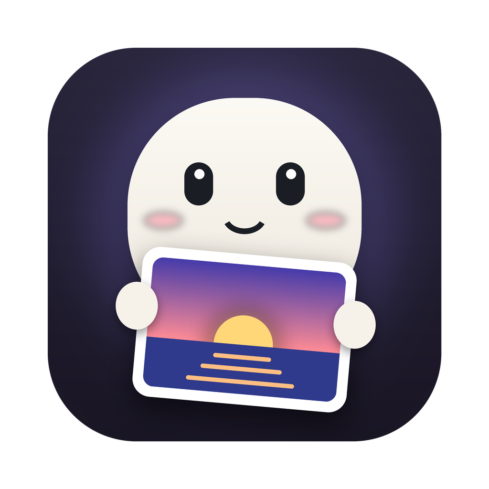
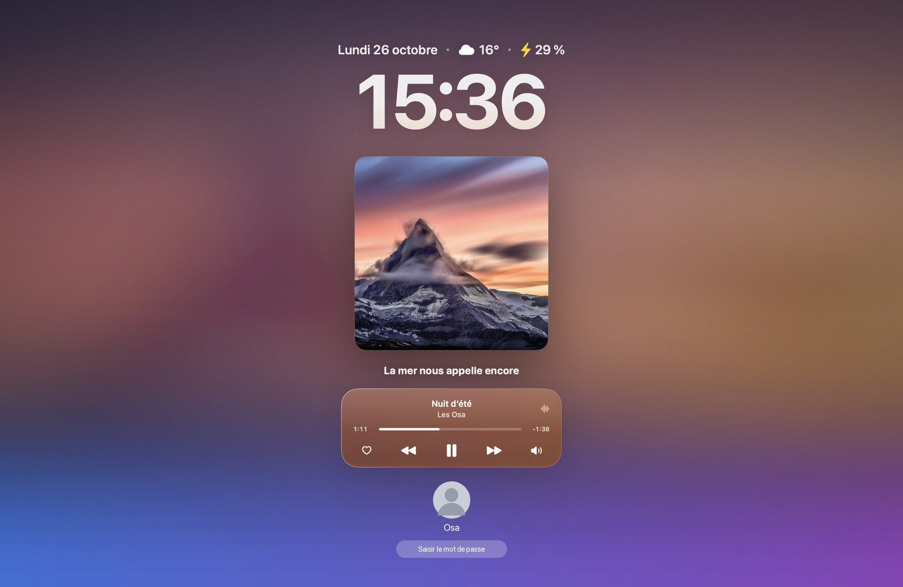
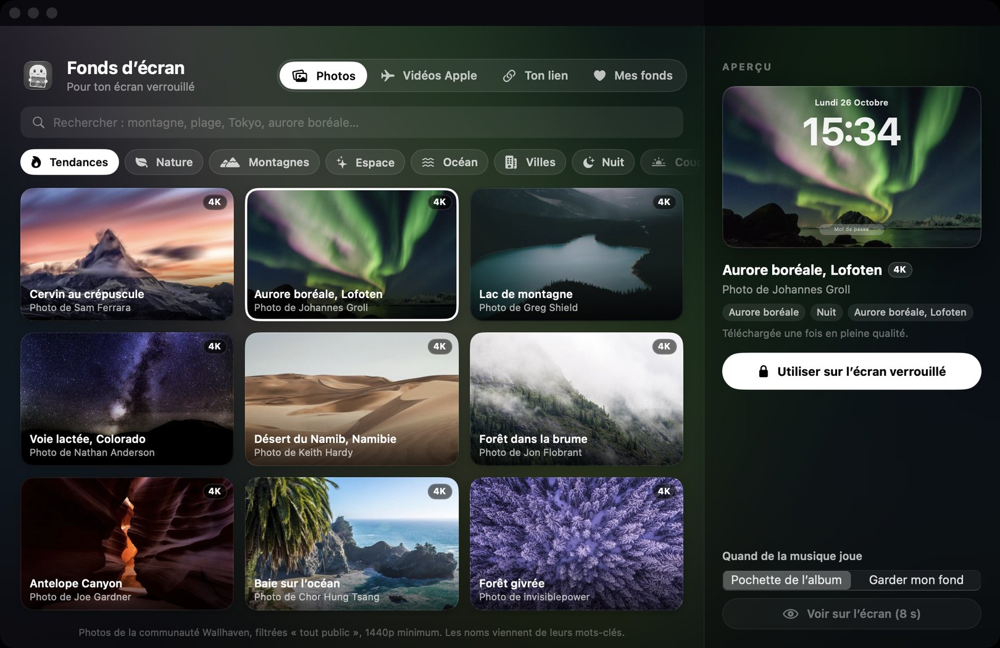
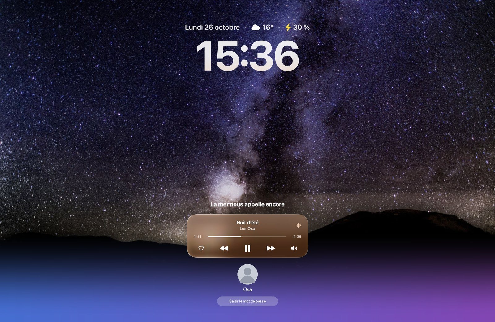
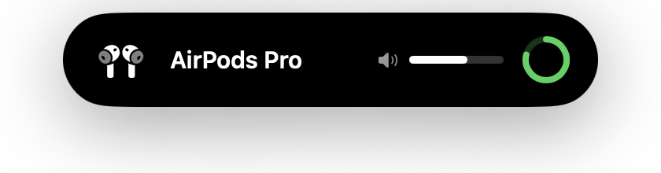
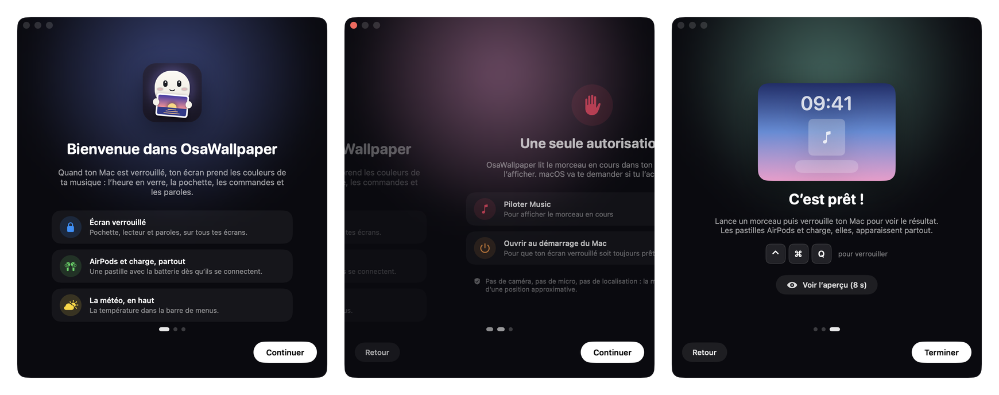

<div align="center">



# OsaWallpaper

### Ton écran verrouillé prend les couleurs de ta musique.

L’heure en verre, la pochette du morceau en cours, ses commandes et ses paroles, directement sur l’écran verrouillé de ton Mac.
Et partout ailleurs, tes AirPods, ta charge, le volume, la luminosité et la météo, en un coup d’œil.


</div>

<p align="center">
  
</p>
<p align="center"><sub>Capture en mode démo (fond d’écran et connexion macOS simulés en bas) : la photo et le champ du mot de passe restent visibles.</sub></p>

---

## 🔒 Sur l’écran verrouillé

Quand ton Mac est verrouillé et qu’un morceau joue dans **Music** ou **Spotify** :

- **Les pochettes animées d’Apple Music.** Quand l’artiste a fait une pochette animée (comme sur l’iPhone), elle devient tout ton fond d’écran, en vidéo. Elle est téléchargée une seule fois puis gardée en cache.
- **Sinon, la pochette devient le fond.** Floutée, mêlée à un dégradé de ses propres couleurs avec un grain léger, elle remplit l’écran et se fond vers le bas pour laisser visibles ta photo et le champ du mot de passe.
- **L’heure, comme sur l’iPhone.** En SF Pro Bold aux chiffres serrés, une pointe de la couleur de la pochette, avec la date et la météo.
- **La pochette en relief.** Elle s’incline doucement vers ta souris.
- **Un lecteur en verre clair.** Titre, progression, favori, précédent / lecture / suivant, sortie audio.
- **Les paroles synchronisées**, ligne par ligne (base [LRCLIB](https://lrclib.net) : les titres très confidentiels n’y sont pas toujours). Elles tiennent compte du retard du son dans les AirPods et casques Bluetooth, et le lecteur ne bouge pas quand une ligne est plus longue.
- **Sur tous tes écrans**, y compris les écrans externes.

Dès que tu déverrouilles, tout disparaît : ton bureau reste exactement comme avant.

## 🖼️ Ton propre fond d’écran

Menu OsaWallpaper → **Ouvrir OsaWallpaper…** ouvre une galerie avec un aperçu en direct sur une maquette de l’écran verrouillé :

<div align="center">
  
</div>


- **Photos** : des milliers de fonds en 1440p minimum (souvent en 4K) venus de [Wallhaven](https://wallhaven.cc), filtrés « tout public ». Chaque photo a un nom en français tiré de ses mots-clés (« Lofoten, Norvège », « Mount Fuji, Japon ») et le nom de son photographe. La recherche comprend le français (« montagne enneigée », « aurore boréale », « Tokyo ») ; tu peux aussi choisir un thème : nature, montagnes, espace, océan, villes, nuit, etc.
- **Vidéos Apple** : les vidéos aériennes de l’Apple TV et de l’économiseur d’écran (Terre, paysages, villes, sous l’eau), en 1080p et en boucle.
- **Ton lien** : colle une vidéo **YouTube** (lue en direct par le lecteur officiel, en sourdine) ou un lien direct **.mp4 / .mov / .jpg / .png**. Tu peux aussi glisser un fichier depuis ton Mac.
- **Mes fonds** : les 40 derniers fonds utilisés, pour revenir à l’un d’eux en un clic.

**Aussi sur le bureau** (dans la galerie ou les réglages) : le même fond devient celui de ton Mac déverrouillé. Pour une vidéo, tu choisis **Animé** (elle tourne en boucle derrière tes fenêtres, en pause dès que le Mac est verrouillé, en veille ou en économie d’énergie) ou **Image fixe** (une image tirée de la vidéo, zéro CPU). Ton fond d’origine est remis quand tu coupes l’option.

**Fondu ou plein écran** : par défaut ton fond se fond vers le bas pour laisser voir ta photo de session et le champ du mot de passe. En **plein écran**, il couvre tout l’écran ; ta photo de session, ton nom et le champ du mot de passe restent visibles par-dessus, sans trou (pour ça, pendant que le Mac est verrouillé seulement, la même image est posée en fond macOS ; ton bureau retrouve son fond au déverrouillage). Pour une vidéo, OsaWallpaper redessine ta photo et ton nom à leur place exacte (lue par l’Accessibilité) : la vidéo tourne partout, seul le champ du mot de passe reste ouvert. En plein écran, la pochette d’un morceau couvre elle aussi tout l’écran, avec ta photo et ton nom redessinés par-dessus ; en mode fondu, elle se fond sur ton fond d’écran d’origine.

**Réglages** : un onglet de la fenêtre, à droite de « Mes fonds » (menu → Réglages…, ⌘,).

**Écran allumé plus longtemps** : macOS éteint très vite l’écran d’un Mac verrouillé. Par défaut OsaWallpaper ne change rien ; dans les réglages, tu peux le garder allumé 1, 2, 5, 10 ou 30 minutes après ta dernière action, puis macOS l’éteint. Jamais en mode économie d’énergie.

**Dans le Dock seulement quand tu t’en sers** : l’icône apparaît quand la fenêtre est ouverte. Quand tu les fermes (ou ⌘Q), elle disparaît et une pastille « App mise en arrière-plan » le dit : l’app continue de tourner pour l’écran verrouillé. Pour la quitter vraiment : ⌥⌘Q ou le menu de la barre des menus.

Sans musique, l’écran verrouillé montre ton fond avec l’heure et la météo. Quand un morceau joue, tu choisis ce qui s’affiche : la pochette de l’album ou ton fond, avec le lecteur par-dessus.

<div align="center">
  
  <br><sub>Captures de l’app (mode démo). Photos d’exemple : CC0, Unsplash via Wikimedia Commons.</sub>
</div>

## ✨ Partout, tout le temps

<p align="center">
  
</p>

| | |
|---|---|
| 🎧 **AirPods et casques** | Dès qu’un casque Bluetooth se connecte, une pastille apparaît en haut de l’écran avec sa batterie et le volume, au-dessus de toutes tes apps, même en plein écran. L’icône est celle de ton modèle exact : AirPods, AirPods 3 ou 4, AirPods Pro, AirPods Max ou Beats. |
| ⚡ **Charge** | Branche ton Mac : une pastille « En charge » s’affiche avec le pourcentage. |
| 🔊 **Volume** | Une pastille discrète avec le niveau, l’icône de ton casque s’il est connecté. |
| ☀️ **Luminosité** | Une pastille quand tu appuies sur F1 / F2. |
| 🙈 **Adieu les indicateurs de macOS** | Avec l’autorisation Accessibilité (facultative), OsaWallpaper gère lui-même les touches son et luminosité : seules ses pastilles s’affichent. |
| 🌤️ **Météo** | La température et le ciel sur l’écran verrouillé et dans le menu de la mascotte (Open-Meteo, sans clé ni compte). |

## 👋 Premier lancement

<p align="center">
  
</p>

Une fenêtre de bienvenue te guide en trois étapes :

1. **Bienvenue** : ce que fait l’app.
2. **Autorisation** : OsaWallpaper a seulement besoin de **piloter Music (ou Spotify)** pour lire le morceau en cours. Un clic sur « Autoriser » fait apparaître la demande de macOS. Tu peux aussi l’ouvrir au démarrage du Mac, et autoriser (facultatif) l’accès Accessibilité pour la pastille de luminosité.
3. **C’est prêt** : un bouton d’aperçu pour voir le résultat sans verrouiller.

Pas de caméra, pas de micro, pas de localisation : la météo utilise une position approximative déduite de ta connexion, ou la ville de ton choix.

## 📦 Installation

1. Télécharge `OsaWallpaper.dmg` depuis les [Releases](../../releases) et glisse l’app dans **Applications**.
2. Ouvre-la. L’app n’est pas notarisée : la première fois, fais **clic droit → Ouvrir**.
3. Suis la fenêtre de bienvenue, lance un morceau, puis verrouille ton Mac avec <kbd>⌃</kbd> <kbd>⌘</kbd> <kbd>Q</kbd>.

Dans la barre des menus, la mascotte se promène en rond, en 3D : elle se tourne dans le sens de sa marche, passe devant puis au fond, un pied après l’autre (animée par Core Animation : l’app ne fait rien à chaque image). Son menu donne la météo, le morceau en cours, l’accès à l’app, à l’aperçu et aux réglages.

### 🔄 Mises à jour

OsaWallpaper regarde les [Releases](../../releases) de ce dépôt au lancement puis toutes les heures, et s’installe tout seul : rien à cliquer. Il télécharge la nouvelle version, vérifie qu’elle est signée par le même développeur, remplace l’app et se relance, au moment où ça ne gêne pas (Mac déverrouillé, aucune fenêtre ouverte) ; une pastille annonce ensuite la mise à jour. Désactivable dans les réglages.

## 🛠️ Compiler

```bash
git clone https://github.com/osayanis/osawallpaper.git
cd osawallpaper
./build.sh        # → OsaWallpaper.app
./make-dmg.sh     # → OsaWallpaper.dmg (fenêtre d’installation à glisser)
```

Prérequis : Xcode 16 ou plus récent (Swift 6).

**Mode démo** (un faux morceau, sans toucher à tes apps de musique) :

```bash
OSAWALLPAPER_DEMO=/chemin/vers/une/image.jpg ./OsaWallpaper.app/Contents/MacOS/OsaWallpaper
```

## ⚙️ Comment ça marche

| Fonction | Technique |
|---|---|
| Afficher sur l’écran verrouillé | Les fenêtres sont placées dans un espace [SkyLight](https://github.com/Lakr233/SkyLightWindow) plus haut que l’écran de verrouillage (API privée, même technique qu’[OsaNotch](https://github.com/osayanis/osanotch-native)). Elles ne deviennent jamais « clé » : ton mot de passe va toujours à macOS. |
| Écran allumé | Assertion IOKit `PreventUserIdleDisplaySleep`, prise seulement pendant que le Mac est verrouillé et relâchée après le délai choisi sans activité. |
| Verrouillé ou non | Notifications `com.apple.screenIsLocked` / `screenIsUnlocked`. |
| Clics | Les fenêtres laissent passer la souris partout, sauf sur les boutons. |
| Musique | `osascript` en sous-processus, une seule requête à la fois, Music ou Spotify. La progression est calculée localement. |
| Pochette | Celle du fichier dans Music, sinon recherche iTunes. Le flou est calculé une seule fois par morceau avec Core Image. |
| Paroles | [LRCLIB](https://lrclib.net), même artiste et même durée (±4 s) que le morceau joué. Position relue toutes les 1,5 s et recalée dès 0,25 s d’écart, moins la latence de la sortie audio (CoreAudio). L’app ne se réveille qu’au début de chaque ligne. Apple Music et Spotify ne donnent pas accès à leurs paroles synchronisées aux autres apps. |
| AirPods | Sortie audio par défaut surveillée via CoreAudio, sans permission Bluetooth. Batterie et modèle (Product ID, même si tu as renommé tes AirPods) lus dans `system_profiler`. |
| Charge | Notifications IOKit (`IOPSNotificationCreateRunLoopSource`) + `notify`. |
| Volume | Écouteur CoreAudio sur le volume et la sourdine de la sortie par défaut. |
| Luminosité | `DisplayServicesGetBrightness` (framework privé) lu 5 fois par seconde, pastille seulement après F1 / F2. |
| Pochettes animées | Page de l’album sur music.apple.com (JSON `serialized-server-data`, vidéo `motionDetailSquare`), qualité 1080p HEVC téléchargée une fois, lue en boucle avec `AVPlayerLooper` seulement quand l’écran est verrouillé. Méthode non officielle. |
| Indicateurs natifs | Interception des touches spéciales (`CGEventTap`), son réglé via CoreAudio, luminosité via `DisplayServicesSetBrightness`. |
| Fonds personnalisés | Photos : API publique de Wallhaven. Vidéos Apple : catalogue public `resources-16.tar` (noms en français), vidéo téléchargée une fois. Fichiers et liens copiés dans `~/Library/Application Support/OsaWallpaper`. Vidéos lues avec `AVPlayerLooper`, seulement quand on peut les voir. Bureau : `NSWorkspace.setDesktopImageURL` + une fenêtre au niveau du bureau pour la vidéo. |
| YouTube | Lecteur intégré officiel (`youtube-nocookie.com`) dans une `WKWebView`, en sourdine et en boucle, créée seulement quand l’écran verrouillé est visible. Rien n’est téléchargé. |
| Mises à jour | API GitHub Releases, archive `OsaWallpaper.zip`, signature vérifiée avec `SecStaticCode`. |
| Météo | [Open-Meteo](https://open-meteo.com), position par IP ou ville choisie. |

**Sobriété** : environ 0,2 % de CPU quand rien ne joue, ~20 à 30 Mo de RAM.

## ⚠️ Limites

- L’affichage sur l’écran verrouillé repose sur une **API privée** de macOS : une future version du système peut le casser.
- La batterie des AirPods vient de `system_profiler` : elle peut mettre quelques secondes à apparaître après la connexion.
- Les pochettes animées passent par la page web d’Apple Music, pas par une API officielle : si Apple la modifie, l’app revient simplement à la pochette fixe. Tous les albums n’en ont pas.
- Une vidéo YouTube demande une connexion internet, et certains auteurs interdisent l’intégration hors de YouTube : l’app le détecte et te prévient.
- Les vidéos Apple pèsent 150 à 300 Mo chacune (téléchargées une seule fois).
- Les photos de Wallhaven appartiennent à leurs auteurs : elles sont pour ton usage personnel.
- Spotify : pas de bouton favori (son AppleScript ne le permet pas).

---

<div align="center">

Fait par <a href="https://github.com/osayanis">Yanis</a> · <a href="https://osalabs.fr">OsaLabs</a><br>
<sub>Avec ses cousins <a href="https://github.com/osayanis/osanotch-native">OsaNotch</a>, OsaDrop, OsaCast et OsaParty.</sub>

</div>
