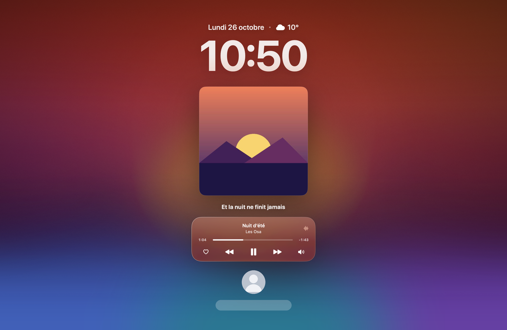

<div align="center">


# OsaWallpaper

### Ton écran verrouillé prend les couleurs de ta musique.

L’heure en verre, la pochette du morceau en cours, ses commandes et ses paroles, directement sur l’écran verrouillé de ton Mac.
Et partout ailleurs, tes AirPods, ta charge, le volume, la luminosité et la météo, en un coup d’œil.


</div>

<p align="center">
  
</p>
<p align="center"><sub>Capture en mode démo (fond d’écran et connexion macOS simulés en bas) : la photo et le champ du mot de passe restent visibles.</sub></p>

---

## 🔒 Sur l’écran verrouillé

Quand ton Mac est verrouillé et qu’un morceau joue dans **Music** ou **Spotify** :

- **Les pochettes animées d’Apple Music.** Quand l’artiste a fait une pochette animée (comme sur l’iPhone), elle devient tout ton fond d’écran, en vidéo. Elle est téléchargée une seule fois puis gardée en cache.
- **Sinon, la pochette devient le fond.** Floutée, mêlée à un dégradé de ses propres couleurs avec un grain léger, elle remplit l’écran et se fond vers le bas pour laisser visibles ta photo et le champ du mot de passe.
- **L’heure, comme sur l’iPhone.** En SF Pro Bold aux chiffres serrés, une pointe de la couleur de la pochette, avec la date et la météo.
- **La pochette en relief.** Elle s’incline doucement vers ta souris.
- **Un lecteur en verre clair.** Titre, progression, favori, précédent / lecture / suivant, sortie audio.
- **Les paroles synchronisées**, ligne par ligne (base [LRCLIB](https://lrclib.net) : les titres très confidentiels n’y sont pas toujours).
- **Sur tous tes écrans**, y compris les écrans externes.

Dès que tu déverrouilles, tout disparaît : ton bureau reste exactement comme avant.

## ✨ Partout, tout le temps

<p align="center">
  
</p>

| | |
|---|---|
| 🎧 **AirPods et casques** | Dès qu’un casque Bluetooth se connecte, une pastille apparaît en haut de l’écran avec sa batterie et le volume, au-dessus de toutes tes apps, même en plein écran. |
| ⚡ **Charge** | Branche ton Mac : une pastille « En charge » s’affiche avec le pourcentage. |
| 🔊 **Volume** | Une pastille discrète avec le niveau, l’icône de ton casque s’il est connecté. |
| ☀️ **Luminosité** | Une pastille quand tu appuies sur F1 / F2. |
| 🙈 **Adieu les indicateurs de macOS** | Avec l’autorisation Accessibilité (facultative), OsaWallpaper gère lui-même les touches son et luminosité : seules ses pastilles s’affichent. |
| 🌤️ **Météo** | La température et le ciel dans la barre de menus (Open-Meteo, sans clé ni compte). |

## 👋 Premier lancement

<p align="center">
  
</p>

Une fenêtre de bienvenue te guide en trois étapes :

1. **Bienvenue** : ce que fait l’app.
2. **Autorisation** : OsaWallpaper a seulement besoin de **piloter Music (ou Spotify)** pour lire le morceau en cours. Un clic sur « Autoriser » fait apparaître la demande de macOS. Tu peux aussi l’ouvrir au démarrage du Mac, et autoriser (facultatif) l’accès Accessibilité pour la pastille de luminosité.
3. **C’est prêt** : un bouton d’aperçu pour voir le résultat sans verrouiller.

Pas de caméra, pas de micro, pas de localisation : la météo utilise une position approximative déduite de ta connexion, ou la ville de ton choix.

## 📦 Installation

1. Télécharge `OsaWallpaper.dmg` depuis les [Releases](../../releases) et glisse l’app dans **Applications**.
2. Ouvre-la. L’app n’est pas notarisée : la première fois, fais **clic droit → Ouvrir**.
3. Suis la fenêtre de bienvenue, lance un morceau, puis verrouille ton Mac avec <kbd>⌃</kbd> <kbd>⌘</kbd> <kbd>Q</kbd>.

L’icône dans la barre de menus donne accès aux réglages, à l’aperçu et à l’ouverture au démarrage.

### 🔄 Mises à jour

OsaWallpaper regarde les [Releases](../../releases) de ce dépôt au lancement puis toutes les 12 h. Quand une nouvelle version sort, il propose de l’installer : il la télécharge, vérifie qu’elle est signée par le même développeur, remplace l’app et se relance. Désactivable dans les réglages, ou à la demande via « Rechercher des mises à jour… ».

## 🛠️ Compiler

```bash
git clone https://github.com/osayanis/osawallpaper.git
cd osawallpaper
./build.sh        # → OsaWallpaper.app
./make-dmg.sh     # → OsaWallpaper.dmg (fenêtre d’installation à glisser)
```

Prérequis : Xcode 16 ou plus récent (Swift 6).

**Mode démo** (un faux morceau, sans toucher à tes apps de musique) :

```bash
OSAWALLPAPER_DEMO=/chemin/vers/une/image.jpg ./OsaWallpaper.app/Contents/MacOS/OsaWallpaper
```

## ⚙️ Comment ça marche

| Fonction | Technique |
|---|---|
| Afficher sur l’écran verrouillé | Les fenêtres sont placées dans un espace [SkyLight](https://github.com/Lakr233/SkyLightWindow) plus haut que l’écran de verrouillage (API privée, même technique qu’[OsaNotch](https://github.com/osayanis/osanotch-native)). Elles ne deviennent jamais « clé » : ton mot de passe va toujours à macOS. |
| Verrouillé ou non | Notifications `com.apple.screenIsLocked` / `screenIsUnlocked`. |
| Clics | Les fenêtres laissent passer la souris partout, sauf sur les boutons. |
| Musique | `osascript` en sous-processus, une seule requête à la fois, Music ou Spotify. La progression est calculée localement. |
| Pochette | Celle du fichier dans Music, sinon recherche iTunes. Le flou est calculé une seule fois par morceau avec Core Image. |
| Paroles | [LRCLIB](https://lrclib.net). L’app ne se réveille qu’au début de chaque ligne. |
| AirPods | Sortie audio par défaut surveillée via CoreAudio, sans permission Bluetooth. Batterie lue dans `system_profiler`. |
| Charge | Notifications IOKit (`IOPSNotificationCreateRunLoopSource`) + `notify`. |
| Volume | Écouteur CoreAudio sur le volume et la sourdine de la sortie par défaut. |
| Luminosité | `DisplayServicesGetBrightness` (framework privé) lu 5 fois par seconde, pastille seulement après F1 / F2. |
| Pochettes animées | Page de l’album sur music.apple.com (JSON `serialized-server-data`, vidéo `motionDetailSquare`), qualité 1080p HEVC téléchargée une fois, lue en boucle avec `AVPlayerLooper` seulement quand l’écran est verrouillé. Méthode non officielle. |
| Indicateurs natifs | Interception des touches spéciales (`CGEventTap`), son réglé via CoreAudio, luminosité via `DisplayServicesSetBrightness`. |
| Mises à jour | API GitHub Releases, archive `OsaWallpaper.zip`, signature vérifiée avec `SecStaticCode`. |
| Météo | [Open-Meteo](https://open-meteo.com), position par IP ou ville choisie. |

**Sobriété** : environ 0,2 % de CPU quand rien ne joue, ~20 à 30 Mo de RAM.

## ⚠️ Limites

- L’affichage sur l’écran verrouillé repose sur une **API privée** de macOS : une future version du système peut le casser.
- La batterie des AirPods vient de `system_profiler` : elle peut mettre quelques secondes à apparaître après la connexion.
- Les pochettes animées passent par la page web d’Apple Music, pas par une API officielle : si Apple la modifie, l’app revient simplement à la pochette fixe. Tous les albums n’en ont pas.
- Spotify : pas de bouton favori (son AppleScript ne le permet pas).

---

<div align="center">

Fait par <a href="https://github.com/osayanis">Yanis</a> · <a href="https://osalabs.fr">OsaLabs</a><br>
<sub>Avec ses cousins <a href="https://github.com/osayanis/osanotch-native">OsaNotch</a>, OsaDrop, OsaCast et OsaParty.</sub>

</div>
